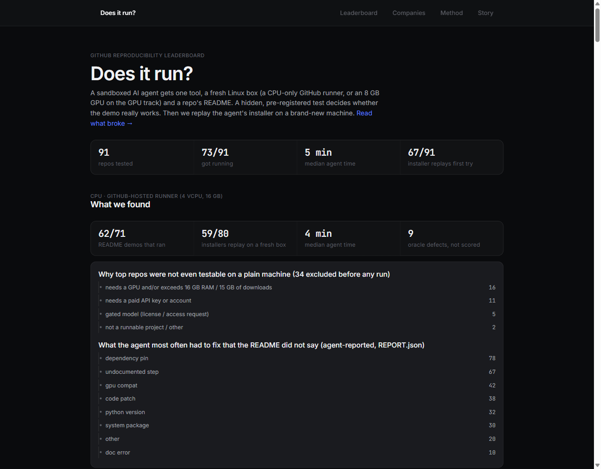

# Does it run?

**How hard is it to get a GitHub repo's README demo actually running?**
A sandboxed AI agent tries, a hidden test decides, and the agent's installer is replayed on a brand-new machine.

**Live leaderboard → https://jumbokun.github.io/doesitrun/** · **The story: [what broke](STORY.md)**

[](https://jumbokun.github.io/doesitrun/)

### Results so far (2026-10-27)

**CPU track — 80 repos, 10 from each of Google, Meta, Microsoft, NVIDIA, Alibaba, Tencent, ByteDance, Baidu**
(GitHub-hosted runner, no GPU; chosen by a pre-registered rule from each company's 25 most-starred Python repos):

| | |
|---|---|
| README demo actually ran (hidden test passed) | **62 / 80**, median agent time 4.2 min; 4 hit the 90-min cap |
| Of the 62 that ran: installer replays on a fresh machine | 59 first try, the other 3 after one repair round |
| Repos where the agent modified at least one of the repo's own files | 30 / 80 (measured with `git diff`) |
| Top repos not even testable on a plain machine | 34 of 114 examined: GPU or >16 GB (16), paid API key (11), gated model (5), other (2) |
| Failed hidden tests, after independent audit | 6 genuine repo failures (e.g. BERT's and trax's README model links now 403, SPADE's 404), **9 defective tests** (unscored), 3 inconclusive (stay 0) |

| company (mean score, n) | | teams (split only where GitHub org accounts show it) |
|---|---|---|
| Microsoft | 93 (9) | one org account; no reliable team split |
| Meta | 93 (8) | FAIR 93 |
| Alibaba | 84 (10) | Qwen 93 · ModelScope 78 |
| Baidu | 83 (9) | Baidu 88 · PaddlePaddle 82 |
| Google | 70 (9) | DeepMind 89 · Google 74 · Google Research 53 |
| NVIDIA | 59 (8) | NVIDIA Research 61 · NVIDIA 56 — a CPU track is hard on CUDA-first repos |
| Tencent | 64 (9) | ARC Lab 94 · Tencent 76 · **Hunyuan 39** |
| ByteDance | 55 (9) | ByteDance 58 · Seed 44 |

**GPU track — 11 repos on an RTX 5060 8 GB:** 11/11 ran, 8/11 installers replayed first try. All six
2020–23 repos needed a newer PyTorch than they pin (old pins have no Blackwell kernels), and five of the six
also needed patches to their own code.

The live page is the source of truth; this table is a snapshot. One run per repo: treat small gaps as noise.
A run whose agent hit the 90-minute cap stays 0 whatever its audit says (the test never had a finished install to
judge). Three Tencent failures were audited twice by mistake; both verdicts are kept in the records, and they
disagreed once (Hunyuan3D-2.1: defect vs inconclusive) — borderline audits are not perfectly stable.

## Get your repo tested, or dispute a result

- **Request a test:** open a [“Test my repo” issue](https://github.com/jumbokun/doesitrun/issues/new?template=test-my-repo.yml).
- **Think a result is wrong?** Open a [“Dispute a result” issue](https://github.com/jumbokun/doesitrun/issues/new?template=dispute-a-result.yml)
  with evidence. Corrections are made in the open and logged in [`WORKLOG.md`](WORKLOG.md).
- **Badge for your README** (tested repos only):

  ```markdown
  
  ```

  

## How a run works

```
README demo ──► agent (Claude Code, ONE tool: `docker exec` into a throwaway container)
                 │   CPU track: GitHub-hosted Ubuntu runner, 4 vCPU / 16 GB, no GPU
                 │   GPU track: Ubuntu 24.04 · CUDA 12.8 · RTX 5060 8 GB (Blackwell, sm_120)
                 ▼
            hidden oracle  ── written before the run, copied in only after the agent stops
                 ▼
            replay setup.sh on a FRESH container ──► oracle again
```

- **Goal** is the repo's own documented demo (e.g. MarkItDown converting its bundled docx/xlsx/pptx/pdf samples
  on the CPU track; StyleGAN2-ADA's `generate.py` with its CUDA plugins actually compiled on the GPU track). Pass/fail is decided by `oracles/<repo>.sh`, never by
  the agent's own claim.
- **Deliverables** from the agent: `setup.sh` (from scratch, non-interactive), `env.sh`, `run.sh` for
  servers, `NOTES.md`, and (CPU track) a typed `REPORT.json` of every deviation from the README.
- **Replay**: `setup.sh` runs on a fresh container and the oracle runs again. If that fails, the log goes
  back to the same agent session for one repair round and the repaired installer is replayed again; the
  first failure stays on record. (MDM: not self-contained at first, passed after a 14-minute repair.)

## Tracks and batches

Scores are only compared within a hardware track.

| track | hardware | repos | how they were chosen |
|---|---|---|---|
| `gpu-rtx5060` | RTX 5060 Laptop 8 GB, local | 11 | batch 1: five 2026 releases; batch 2: six 2020–23 research repos with install complaints |
| `cpu-gha` | GitHub-hosted runner, 4 vCPU / 16 GB, no GPU | 80 | per company, top 25 Python repos by stars across its official orgs; the first 10 an examiner rules eligible |

The `cpu-gha` track runs entirely on GitHub Actions ([`exam.yml`](.github/workflows/exam.yml),
[`probe.yml`](.github/workflows/probe.yml)). An **examiner agent** reads each candidate (no install) and
either excludes it with a reason or writes the goal and hidden oracle; those are committed *before* any
probe runs, so the commit history is the pre-registration. Candidate pool: [`data/candidates.json`](data/candidates.json);
verdicts: `data/exams/`; run records: `data/runs/`.

## Oracle audits

Examiner-written oracles can be wrong (python-fire's asserted the word "usage" in help output that is
man-page style). Rule, committed before any audit ran and applied to every CPU-track repo whose hidden oracle
failed on the agent's container (amended once afterwards, see below and WORKLOG.md):

1. A fresh container replays the agent's `setup.sh`, the unchanged oracle runs under `bash -x`.
2. An independent **auditor agent** (Opus, `sh` into that container only) reads the oracle, its trace, the
   goal it was meant to check and the repo's README, and rules one of:
   `repo_failure` (install/demo genuinely broken), `oracle_defect` (the oracle asserts something the README
   never promised, or depends on its own environment), `inconclusive`.
3. `oracle_defect` → the repo is **not scored** (neither pass nor fail) and is labelled on the page;
   the oracle and its verdict stay in the record. Nothing is ever flipped to a pass.
4. *Amendment, made after the batch:* if the agent hit the 90-minute cap, the failure stays 0 whatever the
   audit says; the auditor was not told about timeouts, and the oracle never had a finished install to judge.

## Scoring

```
score = 100 − min(50, agent minutes) − min(40, 10 × repo files patched)      (0 if it never ran)
```

Only objective inputs: wall-clock agent time, and repo files changed as measured by `git diff`
on the agent's clone (whitespace ignored) — not the agent's notes, which under-report patches.
Replay is shown next to the score but not in it: it grades the installer we produced, not the repo's authors.

## Who made it

Every repo rolls up to a company (so all of Google's repos form a Google score). Teams are split **only** where
separate GitHub org accounts show them (`google-deepmind`, `google-research`, `Tencent-Hunyuan`, …); Microsoft's
repos all sit under one account, so it has no team split. Company evidence, strongest first:

| confidence | signal |
|---|---|
| high | owning GitHub org (`google-deepmind`, `facebookresearch`, `NVlabs`, `microsoft`, …) |
| medium | company as LICENSE copyright holder or required CLA |
| medium | author affiliations of the README's arXiv paper, via [OpenAlex](https://openalex.org) |
| low | README mentions (academia only, never used for teams; a README naming Google may just cite it) |

Rules live in [`orgs.json`](orgs.json); per-repo evidence in [`data/attribution.json`](data/attribution.json).

## Safety model

The agent never touches the host:

- Its only tool is an MCP server ([`box_mcp.py`](box_mcp.py)) that runs one command via `docker exec`;
  the command string is a single argv element and never reaches a host shell. Every call is logged.
- Headless `claude -p` with `--tools ""`, `--strict-mcp-config`, `--permission-mode dontAsk`, no user settings.
- Containers: no bind mounts, no secrets, `--cap-drop NET_RAW`, `no-new-privileges`, CPU/memory/pid limits.
- Overriding `host.docker.internal` is **not** enough on Docker Desktop: `192.168.65.254` still reaches
  services bound to the host's `127.0.0.1`. Probe containers use a dedicated bridge whose private-range
  egress is rejected in the `DOCKER-USER` chain, plus an `INPUT` reject for traffic to the host itself (on a
  native Linux host the bridge gateway is the host), and cloud metadata and Azure WireServer addresses are
  blocked. [`firewall_check.py`](firewall_check.py) proves it before every batch with host canaries plus a
  positive control. If the check fails, nothing runs.

## Run it yourself

Locally: Windows 11 + Docker Desktop (WSL2) with an NVIDIA GPU. On CI: GitHub-hosted Ubuntu runners
(`RR_IMAGE=rr-cpu`). The firewall works on both and is re-proven before every batch.

```bash
docker build -t rr-base base
python firewall_check.py                        # must print FIREWALL OK
python run_probe.py manimgx                     # one repo from repos.json
python run_probe.py --repos=repos_b2.json lama  # another target list
python leaderboard.py                           # data/runs -> data/leaderboard.json, LEADERBOARD.md
python build_site.py                            # -> _site/index.html (CI does this on push)
```

Requires the Claude Code CLI logged in. To add a repo, append it to a repos file with a goal and write
`oracles/<slug>.sh` *before* running it.

## Layout

| path | what |
|---|---|
| `run_probe.py` | harness: examiner, container → agent → oracle → replay → repair → replay |
| `box_mcp.py` | the agent's single tool |
| `oracles/` | pre-registered pass criteria |
| `repos.json`, `repos_b2.json` | targets and goals per batch |
| `attribute.py`, `orgs.json` | company/team attribution |
| `leaderboard.py`, `build_site.py` | scoring and the static site |
| `WORKLOG.md` | full lab notebook, including every failure and protocol change |

## Limitations

- **One run per repo.** Run-to-run variance is not measured yet; treat small gaps as noise.
- **One agent.** Scores compare repos under the same agent (CPU track: Claude Opus 5.5, pinned; the earlier GPU
  track ran Opus 5). A different agent would move every score.
- **AI-written tests.** 9 of 18 failed hidden tests were the test's fault; every failure is audited, and audits
  of borderline cases are not perfectly stable.
- **Hardware.** The CPU track judges CUDA-first repos on a path their authors may not prioritise. The GPU track is
  one 8 GB Blackwell card, which penalises old PyTorch pins.
- **Selection.** "Top 25 by stars" mixes research code with products. Agent time also moves with download speed.

Every protocol change is logged in [`WORKLOG.md`](WORKLOG.md).

Suggest a repo or dispute a result: open an issue.

## License

[MIT](LICENSE)

---

### 中文简介

**Does it run?** 测的是：一个 GitHub 仓库的 README 演示，到底有多难真正跑起来。

做法是让一个 AI Agent 在隔离的沙箱里照着 README 去装、去跑，由一个事先写好、Agent 看不到的测试来判定成功，
最后再把 Agent 写的安装脚本放到一台全新的机器上重放一遍。榜单按公司汇总；有独立 GitHub 组织账号的团队
（比如谷歌下面的 DeepMind、Google Research）再单独拆分。

CPU 赛道测了八家公司各 10 个热门仓库，共 80 个，其中 62 个的 README 演示能跑通。跑通的 62 个里，59 个的安装脚本
在新机器上一次就能复现，另外 3 个修复一轮后复现。GPU 赛道测了 11 个，全部跑通。
